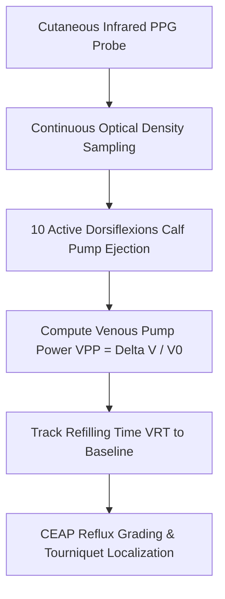

# Cutaneous Venous Refilling Time (VRT) & Venous Pump Power (VPP) Skill

[](LICENSE)
[](https://www.python.org/)
[](https://modelcontextprotocol.io/)
[](requirements.txt)
[](https://github.com/alphaparkinc)

A zero-dependency, mathematically rigorous personal agent skill that evaluates lower-extremity chronic venous insufficiency (CVI), valvular competence, and calf muscle pump ejection power via Digital Photoplethysmography (D-PPG).

## Architecture



## Quick Start

```python
from client import VenousRefillingTimeClient

client = VenousRefillingTimeClient()
result = client.evaluate_venous_hemodynamics(
    venous_refilling_time_seconds=28.5,
    baseline_signal_mv=1000.0,
    post_exercise_nadir_mv=930.0,
    limb_examined="Right Leg"
)
print("VRT (s):", result["hemodynamic_metrics"]["venous_refilling_time_vrt_seconds"])
print("Venous Pump Power (%):", result["hemodynamic_metrics"]["venous_pump_power_vpp_pct"])
print("Valvular Status:", result["clinical_assessment"]["valvular_competence"])
```

## License
Apache-2.0
